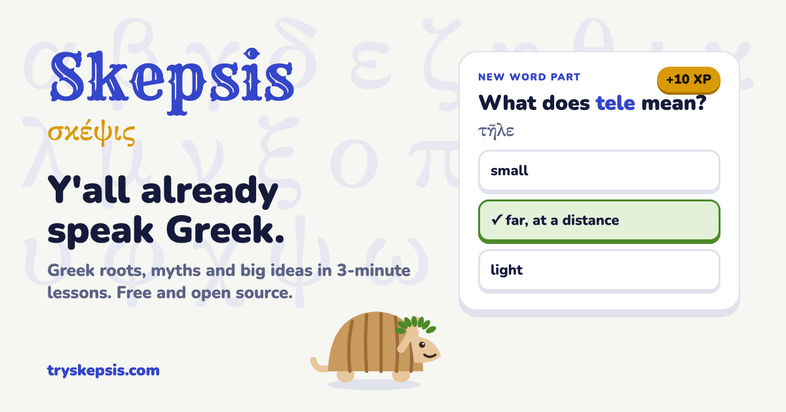

# Skepsis

**Y'all already speak Greek.** Skepsis is a free, open-source game that teaches the Greek roots, myths and big ideas hiding in everyday English, in 3-minute lessons. Every word comes with a Texas example.

**Play:** https://tryskepsis.com · **Every word:** https://tryskepsis.com/words · **Learn from your AI agent:** [MCP server](mcp/README.md) · **iOS app:** [mobile/](mobile/README.md)



*Skepsis* (σκέψις) is Greek for "looking closely". It's where *skeptic* comes from.

## Open source, and the family

Skepsis is free and open source (MIT). **If it helps you, please [star the repo](https://github.com/ionpetro/skepsis)**: a star helps other people find it. Corrections and pull requests are welcome.

Skepsis is one of eight free, open-source learning apps built the same way (short daily lessons and spaced review):

- **Skepsis** (this one): the Greek hiding in everyday English. [Play](https://tryskepsis.com) · [GitHub](https://github.com/ionpetro/skepsis)
- **Carpe**: Latin for Greece's national exams. [Play](https://carpe-latin.vercel.app) · [GitHub](https://github.com/ionpetro/carpe)
- **Gnothi**: Ancient Greek for Greece's national exams. [Play](https://gnothi-greek.vercel.app) · [GitHub](https://github.com/ionpetro/gnothi)
- **Objection**: prep for the US bar exam (MBE). [Play](https://objection-bar.vercel.app) · [GitHub](https://github.com/ionpetro/objection)
- **Agora**: sales and negotiation, with ethics. [Play](https://agora-sales-xi.vercel.app) · [GitHub](https://github.com/ionpetro/agora)
- **Oikos**: economics and incentives. [Play](https://oikos-azure-five.vercel.app) · [GitHub](https://github.com/ionpetro/oikos)
- **Guanxi**: Mandarin and local culture. [Play](https://guanxi-mandarin.vercel.app) · [GitHub](https://github.com/ionpetro/guanxi)
- **Everyday Ethics**: everyday choices and ethical judgment. [Private preview](https://everyday-ethics-ion.wintrypenny4.chatgpt.site) · [GitHub](https://github.com/ionpetro/everyday-ethics)

## What's inside

- **11 units, 33 lessons, 93 Greek roots and ideas** plus a 34-word "Is it Greek?" game.
  - Everyday roots: tele, phon, graph, photo, auto.
  - Size and number: mega, micro, poly, mono.
  - Space and oil: astronaut, petroleum, helium.
  - Medicine: cardio, derm, -itis.
  - Manias and thieves: megalomania, kleptomania, pyrotechnics.
  - Power and people: democracy, -cracy, polis, "Metroplex".
  - Myths: Nike, Achilles' heel, Trojan horse, mentor.
  - Persuasion: ethos, pathos, logos, kairos, hubris.
  - Stoic ideas: dichotomy of control, aretē, eudaimonia.
  - Startup Greek: strategy, crisis, protocol.
  - **Is it Greek? Texas Edition:** rodeo, Alamo and mustang are Spanish; squirrel, butter and oyster are secretly Greek.
- **Six kinds of questions:** guess first, multiple choice, decode a word you've never seen, build a word from its pieces, match pairs, and Greek-or-not.
- **Game parts:** XP, a daily goal, streaks (weekends never break them, plus freezes), badges, and **Rodeo**, a speed round with 8 seconds per question where one miss bucks you off.
- **Teach mode:**
  - Every item has a one-breath explanation and a Copy-for-Slack button.
  - **Huddle** turns a unit into big slides for a standup.
- **Optional team board:** a weekly leaderboard with a shared team goal, when the app is hosted as a Claude Artifact.
- **MCP server:** Claude, Cursor or any MCP agent can tutor you with the same lessons and spaced review.
- **iOS app** ([mobile/](mobile/README.md)): native lessons, Rodeo, daily quests, drachmas and hats for Homer, local reminders and lyre sounds. No account; everything stays on your phone.

## How it teaches

The design follows learning research. Sources, and where the evidence is weak, are in [RESEARCH.md](RESEARCH.md).

- **Guess first.** Each lesson opens on a word you haven't learned. Guessing before you're told helps it stick.
- **Word families, then transfer.** You learn a root with two example words, then decode a third you've never seen.
- **Retrieval, not rereading.** Every new card is quizzed right away, and missed questions come back at the end of the lesson.
- **Spaced review.** Words come back after 1, 3, 7, 14 and 30 days. A miss starts the word over.
- **No punishment.** No hearts, no lives, and the team board is opt-in.

## Learn from your AI agent (MCP)

```bash
claude mcp add skepsis -- npx -y github:ionpetro/skepsis
```

Then ask your agent: *"Start today's Skepsis lesson."* Setup for Claude Desktop and Cursor, and the full list of tools, is in [mcp/README.md](mcp/README.md).

## Run it locally

```bash
git clone https://github.com/ionpetro/skepsis && cd skepsis
npm install
npm test          # content + engine + MCP tests
npm run build     # app/dist/index.html (single-file app) and app/vercel/ (the website)
open app/vercel/index.html
```

| Path | What |
|---|---|
| `app/src/content.js` | All course content: roots, ideas and origins, each with the Greek spelling, meaning, Texas example and a teaching line |
| `app/src/engine.js` | Pure logic: streaks, spaced review, question builders, badges |
| `app/src/app.js`, `style.css`, `shell.html` | The app (plain JS, no framework, no build step beyond inlining) |
| `app/site.mjs` | The website: the app plus a crawlable page for every word, sitemap, share tags |
| `mcp/` | The MCP server |
| `mobile/` | The iOS app (Expo): same lessons, plus quests, drachmas, a shop, reminders. Local-first: progress never leaves the phone |
| `video/` | The 5-second launch video (Remotion) |

## Add a word

Add an item to a lesson in `app/src/content.js` and run `npm test`.

- Each root needs 3 example words. The first two are taught, and the third is held back for the "decode a new word" question.
- Each word's pieces must spell it exactly. The tests check this.

Corrections to etymologies are very welcome. Please cite Etymonline, Merriam-Webster or the LSJ lexicon.

## License

MIT. Made by [Ion Petropoulos](https://ionpetro.com).
